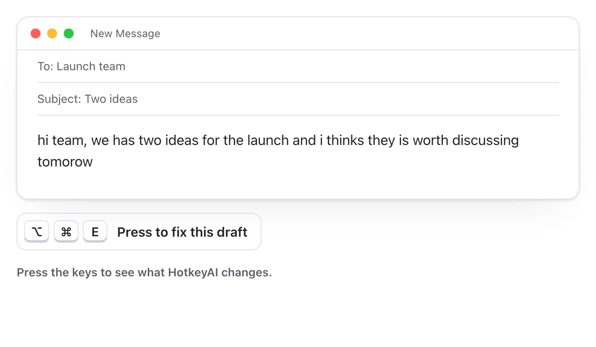

<p align="center">
  
</p>

<h1 align="center">HotkeyAI</h1>

<p align="center">
  <b>Your draft, fixed in place.</b><br>
  Write in any app and press one shortcut. HotkeyAI rewrites the text in the field you are typing in:
  clear, natural English, or your own language without the mistakes. It can also check the facts or
  write a joke or a poem, and you can add any prompt of your own. Free for Mac and Windows.
</p>

<p align="center">
  <a href="https://apps.microsoft.com/detail/9P6DQ3CCTWFX"></a>
  
  <a href="https://github.com/nauroman/HotkeyAI/releases/download/v1.0/HotkeyAI-1.0.dmg"></a>
</p>

<p align="center">
  <a href="https://nauroman.github.io/HotkeyAI/"><b>Website</b></a>
  &nbsp;&nbsp;
  <a href="https://nauroman.github.io/HotkeyAI/privacy.html">Privacy</a>
  &nbsp;&nbsp;
  <a href="https://ko-fi.com/nauroman">Support on Ko-fi</a>
</p>

<p align="center">
  <picture>
    <source media="(prefers-color-scheme: dark)" srcset="docs/images/readme-demo-dark.webp">
    
  </picture>
</p>

## What it does

You write an email, a chat message or a document. Before you send it, press one shortcut.
HotkeyAI takes the text from the field you are typing in, has an AI rewrite it, and puts the better
version back in the same place. You don't copy anything, switch apps or open a chat window.

- Works in any app: Mail, Messages, Outlook, Slack, Word, Google Docs, any browser.
- Lives as a small keycap icon in the menu bar on a Mac, or in the notification area on Windows.
- Puts your clipboard back after every rewrite.
- Every action is just a prompt with a shortcut. Change the built-in ones or add your own:
  "make it shorter", "make it polite", "turn this into bullet points", "reply to this email".

## Six ready-made actions

HotkeyAI starts with six actions so you can try it right away. **They are only examples.** In
Settings → Actions you can change the prompt, the shortcut and the AI of any of them, delete the ones
you don't need, and press **+** to add your own with any prompt you like.

| Action | Mac | Windows | What it does |
| --- | --- | --- | --- |
| Improve in English | <kbd>⌥</kbd> <kbd>⌘</kbd> <kbd>E</kbd> | <kbd>Win</kbd> <kbd>Alt</kbd> <kbd>E</kbd> | Fixes mistakes and translates other languages into natural English |
| Fix in original language | <kbd>⌥</kbd> <kbd>⇧</kbd> <kbd>⌘</kbd> <kbd>O</kbd> | <kbd>Win</kbd> <kbd>Alt</kbd> <kbd>Shift</kbd> <kbd>O</kbd> | Corrects mistakes in the language you typed |
| Do what the text says | <kbd>⌥</kbd> <kbd>⇧</kbd> <kbd>⌘</kbd> <kbd>D</kbd> | <kbd>Win</kbd> <kbd>Alt</kbd> <kbd>Shift</kbd> <kbd>D</kbd> | Carries out the request you typed and puts the result in its place |
| Fact-check | <kbd>⌥</kbd> <kbd>⇧</kbd> <kbd>⌘</kbd> <kbd>F</kbd> | <kbd>Win</kbd> <kbd>Alt</kbd> <kbd>Shift</kbd> <kbd>F</kbd> | Searches the web and says whether the claims are true |
| Joke on this topic | <kbd>⌥</kbd> <kbd>⇧</kbd> <kbd>⌘</kbd> <kbd>J</kbd> | <kbd>Win</kbd> <kbd>Alt</kbd> <kbd>Shift</kbd> <kbd>J</kbd> | Writes a short joke about what you typed |
| Poem on this topic | <kbd>⌥</kbd> <kbd>⇧</kbd> <kbd>⌘</kbd> <kbd>P</kbd> | <kbd>Win</kbd> <kbd>Alt</kbd> <kbd>Shift</kbd> <kbd>P</kbd> | Writes a rhymed poem about what you typed |

Every action answers in the language you wrote in. The result replaces your text; press
<kbd>⌘</kbd> <kbd>Z</kbd> (<kbd>Ctrl</kbd> <kbd>Z</kbd> on Windows) to get it back.

### Improve in English: <kbd>⌥</kbd> <kbd>⌘</kbd> <kbd>E</kbd> on a Mac, <kbd>Win</kbd> <kbd>Alt</kbd> <kbd>E</kbd> on Windows

Fixes spelling, grammar and awkward phrasing. Write in any other language and it translates into
natural, fluent English.

| You type | HotkeyAI writes |
| --- | --- |
| hi team, we has two ideas for the launch and i thinks they is worth discussing tomorow | Hi team, we have two ideas for the launch and I think they are worth discussing tomorrow |
| я не обещал закончить к пятнице | I did not promise to finish by Friday. |

### Fix in original language: <kbd>⌥</kbd> <kbd>⇧</kbd> <kbd>⌘</kbd> <kbd>O</kbd> on a Mac, <kbd>Win</kbd> <kbd>Alt</kbd> <kbd>Shift</kbd> <kbd>O</kbd> on Windows

Corrects mistakes in the language you typed, and keeps your own words and tone.

| You type | HotkeyAI writes |
| --- | --- |
| mañana te envio el informe si todo sale bien | Mañana te envío el informe si todo sale bien. |

### Do what the text says: <kbd>⌥</kbd> <kbd>⇧</kbd> <kbd>⌘</kbd> <kbd>D</kbd> on a Mac, <kbd>Win</kbd> <kbd>Alt</kbd> <kbd>Shift</kbd> <kbd>D</kbd> on Windows

Type what you want instead of writing it yourself, and press the shortcut. The result takes the place
of your request. Select the request to replace only it, for example in a reply below a quoted email.

| You type | HotkeyAI writes |
| --- | --- |
| tell the team the meeting moves to Friday at 3 pm | Hi everyone, the meeting is moving to Friday at 3 pm. See you then! |
| command to find files larger than 100 MB | find . -type f -size +100M |

It works best with ChatGPT, OpenAI, Claude or Gemini. Apple Intelligence runs a small model on your
Mac: it writes short messages well enough, but can get numbers, facts and translations wrong.

### Fact-check: <kbd>⌥</kbd> <kbd>⇧</kbd> <kbd>⌘</kbd> <kbd>F</kbd> on a Mac, <kbd>Win</kbd> <kbd>Alt</kbd> <kbd>Shift</kbd> <kbd>F</kbd> on Windows

Select a sentence, or leave nothing selected to check the whole field. HotkeyAI replaces it with a
short report: a line saying what was checked, the verdict (✅ true, ⚠️ partly true, ❌ false or
❓ can't verify), then each claim with the correct fact, and the sources it found.

Fact-check searches the web, so it needs ChatGPT, OpenAI, Claude or Gemini. Apple Intelligence works
offline and would check facts only from memory, so on a Mac choose another AI for this action.

### Joke and poem on this topic: <kbd>⌥</kbd> <kbd>⇧</kbd> <kbd>⌘</kbd> <kbd>J</kbd> and <kbd>⌥</kbd> <kbd>⇧</kbd> <kbd>⌘</kbd> <kbd>P</kbd> on a Mac, <kbd>Win</kbd> <kbd>Alt</kbd> <kbd>Shift</kbd> <kbd>J</kbd> and <kbd>P</kbd> on Windows

Type a topic, such as "Monday and coffee", or a wish, such as "a birthday poem for my mom, eight
lines", and press the shortcut. A joke or a poem in the same language takes its place.

### Search the web and think longer

Any action can look things up before it answers: turn on **Search the web and think longer** for it
in Settings → Actions. It works with ChatGPT, OpenAI, Claude and Gemini; it is slower and uses more of
your plan or API credit. Fact-check has it on.

## Your choice of AI

Pick one for everything, or a different one for each action. Your text goes only to the AI you picked.

| AI | Where your text goes | Cost | You need |
| --- | --- | --- | --- |
| **Apple Intelligence** (default on a Mac) | Nowhere: it runs on your Mac and works offline | Free | A Mac with Apple silicon and macOS 26 or later. Best for shorter texts. |
| **Sign in with ChatGPT** (default on Windows) | To OpenAI, under your ChatGPT account | Included in ChatGPT Plus or Pro | A ChatGPT Plus or Pro plan |
| **Your own API key**: OpenAI, Claude or Gemini | To OpenAI, Anthropic or Google, under your key | Billed by the provider for each request | A key from that provider |

Apple Intelligence isn't available on Windows. Keys and sign-in tokens stay on your computer: in the
Keychain on a Mac, encrypted for your account on Windows.

## Install

<p>
  <a href="https://apps.microsoft.com/detail/9P6DQ3CCTWFX"></a>
  
  <a href="https://github.com/nauroman/HotkeyAI/releases/download/v1.0/HotkeyAI-1.0.dmg"></a>
</p>

HotkeyAI is installed from the stores.

- **Windows 10 (version 2004 or later) and Windows 11:** the
  [Microsoft Store](https://apps.microsoft.com/detail/9P6DQ3CCTWFX). It installs HotkeyAI and keeps it
  up to date. This is the only Windows download. If your work computer blocks the Store, ask your IT
  department to allow HotkeyAI (Store ID 9P6DQ3CCTWFX).
- **macOS 14 or later:** Apple is reviewing HotkeyAI for the Mac App Store. Until it arrives, download
  [HotkeyAI-1.0.dmg](https://github.com/nauroman/HotkeyAI/releases/download/v1.0/HotkeyAI-1.0.dmg),
  open it and drag HotkeyAI to Applications. It is signed with Developer ID and notarized by Apple.
  Once the Mac App Store version is live, it becomes the only way to install HotkeyAI on a Mac.

## Set up in a minute

**On a Mac**

1. Open HotkeyAI. The keycap icon appears in the menu bar.
2. HotkeyAI opens System Settings → Privacy & Security → Accessibility. Turn on HotkeyAI.
3. Type something in Notes or Mail and press <kbd>⌥</kbd> <kbd>⌘</kbd> <kbd>E</kbd>.
4. No Apple Intelligence? Sign in with ChatGPT or paste an API key in HotkeyAI → Settings → AI Providers.

macOS lets an app press keys for you only with your permission. HotkeyAI uses it to press ⌘A, ⌘C and
⌘V in the field you are typing in, and only when you press one of your shortcuts. It does not read
your screen or record your typing.

**On Windows**

1. Open HotkeyAI from Start. The keycap icon appears in the notification area of the taskbar (it may be under ^).
2. Sign in with your ChatGPT Plus or Pro account, or add an OpenAI, Claude or Gemini API key.
3. Type in any text field and press <kbd>Win</kbd> <kbd>Alt</kbd> <kbd>E</kbd>.

Windows needs no extra permission.

## Privacy

Your text goes from your computer to the AI you chose, and nowhere else. HotkeyAI has no servers, no
account with us, no analytics, no tracking and no ads, and it keeps no copy of your text or the results.
Read the [privacy policy](https://nauroman.github.io/HotkeyAI/privacy.html).

## Questions

<details>
<summary><b>Where is HotkeyAI after I open it?</b></summary>
<br>
It has no window. Look for the keycap icon in the menu bar on a Mac, or in the notification area of the
taskbar on Windows. Click it for your actions and Settings.
</details>

<details>
<summary><b>The switch is on, but HotkeyAI still asks for access</b></summary>
<br>
In Accessibility settings, select HotkeyAI and remove it with −. Then choose <b>Allow keyboard access…</b>
in the HotkeyAI menu and turn it on again.
</details>

<details>
<summary><b>Nothing changes in some Windows apps</b></summary>
<br>
Windows doesn't let other apps type into apps that run as administrator, so HotkeyAI can't change text there.
</details>

<details>
<summary><b>Can I change or remove the built-in actions?</b></summary>
<br>
Yes. They are only examples. In Settings → Actions, edit any action's name, shortcut, prompt and AI,
delete it with −, or press + to add your own. Write the prompt the way you would ask a person:
"Make this shorter and friendlier", "Reply to this email and say yes", "Explain this code". If you
delete one by mistake, choose ⋯ → Add built-in actions again.
</details>

<details>
<summary><b>Is formatting kept?</b></summary>
<br>
No. The result is pasted as plain text. In code editors that copy the current line when nothing is
selected (VS Code, JetBrains), set the action to "Whole field" or "Selected text only".
</details>

<details>
<summary><b>Something doesn't work</b></summary>
<br>
<a href="https://github.com/nauroman/HotkeyAI/issues/new">Open an issue</a>. Say which computer you use
and what the banner at the top of the screen (above the taskbar on Windows) said.
</details>

## Support HotkeyAI

HotkeyAI is free. If it saves you time, you can [leave a tip on Ko-fi](https://ko-fi.com/nauroman).
It pays for the Apple developer membership and for time to keep HotkeyAI updated.

## For developers

<details>
<summary><b>Build, test, release and project layout</b></summary>
<br>

- [DEVELOPMENT.md](DEVELOPMENT.md): the Mac app. Build and test without Xcode, signing, the App Store
  build, icons, project layout, AI provider details and the store-only release rules.
- [windows/README.md](windows/README.md): the Windows app (C#/WPF, MSIX for the Microsoft Store).
- [AppStore/SUBMISSION.md](AppStore/SUBMISSION.md) and [windows/store/SUBMISSION.md](windows/store/SUBMISSION.md):
  everything that goes into App Store Connect and Partner Center.

```bash
scripts/test.sh          # Mac unit tests
scripts/build-app.sh     # → build/HotkeyAI.app
```

HotkeyAI is the successor of [ChatGPTHotkey](https://github.com/nauroman/ChatGPTHotkey); its first two
actions use the same two prompts.
</details>

## License

MIT, see [LICENSE](LICENSE).
